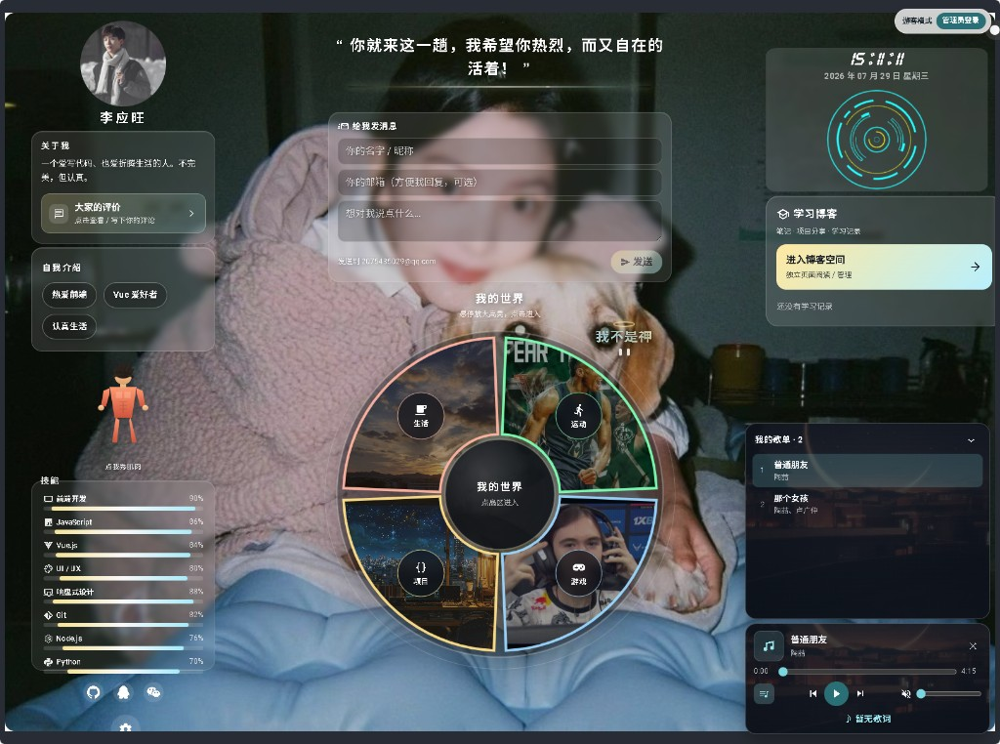
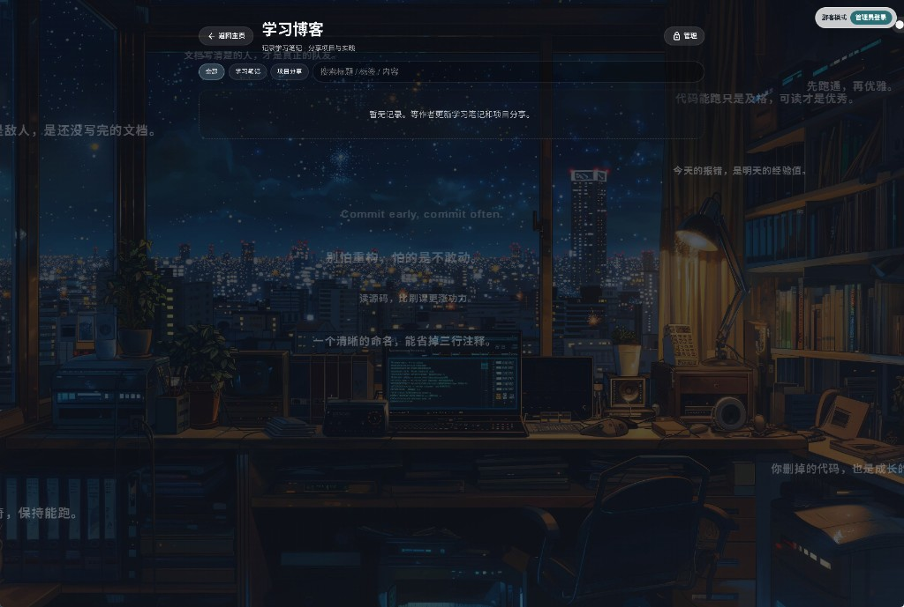
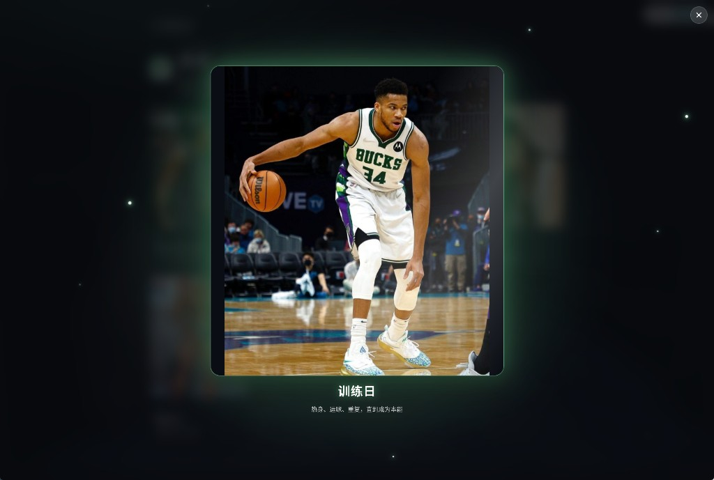
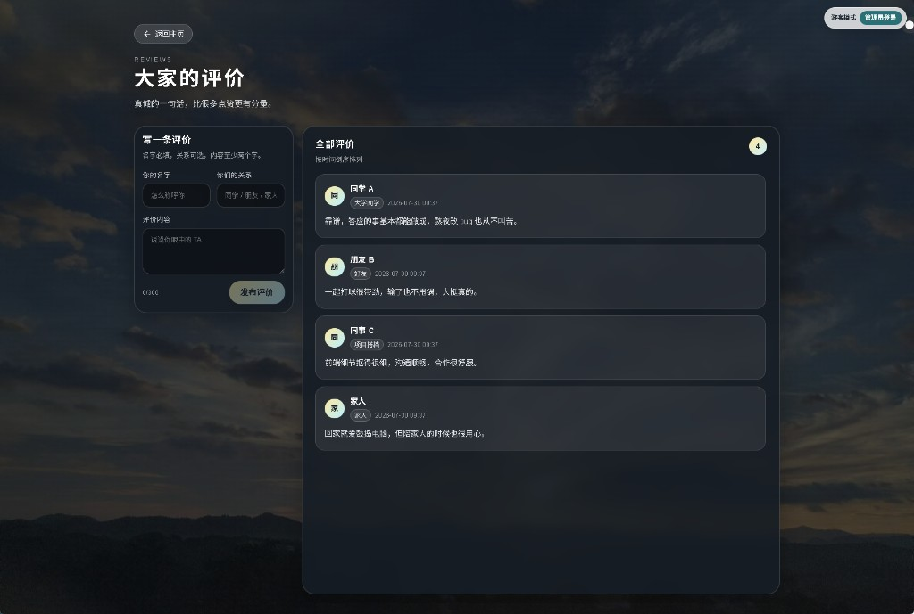

# 个人主页｜我不是神

基于 [leleo-home-page](https://github.com/leleo886/leleo-home-page) 二次开发的 Vue 3 个人主页。  
毛玻璃仪表盘风格，左侧资料、中间「我的世界」转盘与留言、右侧博客与音乐，支持游客浏览与管理员本地编辑。

仓库地址：[https://github.com/lyw313/leleo-home-page](https://github.com/lyw313/leleo-home-page)

---

## 目录

- [效果预览](#效果预览)
- [项目介绍](#项目介绍)
- [小巧思 / 互动彩蛋](#小巧思--互动彩蛋)
- [技术栈](#技术栈)
- [快速开始](#快速开始)
- [配置成自己的站点](#配置成自己的站点)
- [功能模块介绍](#功能模块介绍)
- [部署上线](#部署上线)
- [项目结构](#项目结构)
- [已知不足与后续优化](#已知不足与后续优化)
- [致谢](#致谢)

---

## 效果预览

### 演示视频

<p align="center">
  <a href="./img/preview/demo.mp4">▶️ 点击观看演示视频（约 18MB）</a>
</p>

> GitHub 网页里视频可能不会直接内嵌播放，可点上面链接下载 / 预览，或克隆仓库后本地打开 `img/preview/demo.mp4`。

### 页面截图

**首页总览**



**学习博客空间**



**我的世界 · 卡片大图灯箱**



**大家的评价**



---

## 项目介绍

这是一个可配置的个人主页模板，适合展示：

- 个人简介、兴趣标签、技能进度
- 「生活 / 运动 / 游戏 / 项目」四象限内容空间
- 学习博客笔记与项目分享
- 留言（EmailJS 发信）与「大家的评价」
- 本地歌单与迷你播放器
- 清屏、壁纸，以及下方这些**互动小彩蛋**

**访客**可浏览、留言、评论；输入管理员密码后，可在浏览器内增删改博客、世界模块、个人资料与歌单（数据默认保存在本机 `localStorage` / IndexedDB）。

> ⚠️ **公开仓库前请先修改** `src/config.js` 里的管理员密码、EmailJS 密钥、邮箱与社交链接，避免泄露个人密钥。

---

## 小巧思 / 互动彩蛋

这些是站点里比较有意思的「活物」，建议本地跑起来点一点：

### 「我不是神」小人（页面攀爬者）

页面上会漂浮一个发光标题小人，文案默认是「我不是神」。

| 行为 | 怎么触发 | 效果 |
|------|----------|------|
| **点击空白处移动** | 在页面空白区域单击 | 小人会跑向鼠标点击位置，途中还能攀爬卡片边缘 |
| **点自己会生气** | 连续点击小人本体 | 进入愤怒态：冒火、冒「怒」字气泡，文案变成「不要惹我」 |
| **气炸了** | 短时间内点满约 3 次 | 大爆炸特效 +「爆了!!!」，然后进入复活倒计时，倒计时结束后再回来 |
| **听到歌会兴奋** | 右下角播放器开始播放 | 小人挥动荧光棒手臂，进入听歌跳舞状态（愤怒 / 爆炸时不跳） |

相关组件：`src/components/pageclimber.vue`

### 肌肉小人（点我秀肌肉）

左侧技能条上方的橙色火柴人：

| 行为 | 怎么触发 | 效果 |
|------|----------|------|
| **秀肌肉** | 点击小人 | 随机切换各种摆拍姿势，文案「点我秀肌肉」 |
| **听歌兴奋** | 音乐播放中 | 自动循环换姿势，文案变成「听到歌了！兴奋ing」，带抖动高光 |

相关组件：`src/components/spinbuddy.vue`

### 其它小细节

- **清屏开关**：左上角可隐藏面板，专心看壁纸  
- **世界转盘**：悬停高亮放大，点击进入生活 / 运动 / 游戏 / 项目空间；卡片支持全屏灯箱放大查看  
- **博客飘字**：学习博客背景上会漂浮程序员励志语  
- **技能条悬停**：技能进度条可轻微放大高亮  

---

## 技术栈

| 类别 | 技术 |
|------|------|
| 框架 | Vue 3 |
| UI | Vuetify 3、Material Design Icons |
| 构建 | Vite 5 |
| 样式 | Less、毛玻璃（backdrop-filter） |
| 图表 | Chart.js / vue-chartjs（技能条展示） |
| 留言 | EmailJS |
| 动效 | TypeIt 打字机等 |
| 数据 | 浏览器 localStorage、IndexedDB（音乐文件等） |

---

## 快速开始

### 环境要求

- [Node.js](https://nodejs.org/) 18+（推荐 LTS）
- npm（随 Node 安装）

### 安装与启动

```bash
# 1. 克隆仓库
git clone https://github.com/lyw313/leleo-home-page.git
cd leleo-home-page

# 2. 安装依赖
npm install

# 3. 启动开发服务（带局域网 host）
npm run dev
```

浏览器打开终端里提示的地址，一般是 `http://localhost:5173/`。

### 常用命令

```bash
npm run dev       # 本地开发
npm run build     # 打包到 dist/
npm run preview   # 预览打包结果
```

---

## 配置成自己的站点

几乎所有文案与资源都在 **`src/config.js`**，改完保存后热更新即可。

### 1. 基础信息

```js
metaData: {
  title: '你的名字｜个人主页',
  description: '...',
  keywords: '...',
  icon: '/favicon.ico',
},
avatar: '/img/avatar.jpg',   // 放到 public/img/
username: '你的名字',
welcometitle: '站点标题',
contactEmail: '你的邮箱@qq.com',
```

### 2. 管理员密码（必改）

```js
siteAdmin: {
  password: '改成你自己的密码',
  sessionHours: 2,   // 登录有效时长（小时）
},
```

右上角输入密码即可进入管理员模式；可续期，到期自动退出。

### 3. 关于我 / 标签 / 技能

- `aboutMe`：简介与「大家的评价」种子数据  
- `tags`：自我介绍标签  
- `polarChart.skills`：技能名称与熟练度  

管理员登录后也可在页面内编辑部分资料（见左下角设置 / 资料编辑）。

### 4. 「我的世界」四宫格

修改 `lifeModules`：

- `key` / `title` / `desc` / `cover`：扇区信息与封面  
- `items`：进入后展示的卡片（可带 `image`、`text`、`link`）  

图片建议放在 `public/img/world/` 下，路径写成 `/img/world/...`。

### 5. 留言（EmailJS）

在 [EmailJS](https://www.emailjs.com/) 创建服务与模板后填入：

```js
emailjs: {
  publicKey: '你的 public key',
  serviceId: 'service_xxx',
  templateId: 'template_xxx',
},
```

模板字段需与代码里发送的字段对应（如 `name`、`email`、`message` 等）。

### 6. 音乐

- 音频放到 `public/music/`  
- 在 `musicPlayer.customSongs` 里配置：

```js
{ title: '歌名', author: '歌手', url: '/music/xxx.mp3', pic: '' }
```

可选同目录 `.lrc` 歌词文件；管理员也可在播放器里上传歌曲（存 IndexedDB）。

### 7. 壁纸与社交

- `background`：默认 PC / 移动端壁纸  
- `wallpaper`：可选壁纸列表（静态图 / 视频）  
- `socialPlatformIcons`：GitHub、QQ、微信等按钮链接  
- `typeWriterStrings`：顶部打字机文案  
- `pageBackgrounds`：博客 / 评价 / 音乐等子页背景  

### 8. 换头像与图标

替换 `public/img/avatar.jpg`、`public/favicon.ico` 等即可，注意 `config.js` 中路径一致。

---

## 功能模块介绍

| 模块 | 说明 |
|------|------|
| **左侧资料栏** | 头像、用户名、关于我、自我介绍标签、技能条、社交入口、设置 |
| **打字机名言** | 顶部轮播 / 打字展示个性文案 |
| **留言板** | 姓名、邮箱、内容，经 EmailJS 发到你的邮箱 |
| **我的世界** | 圆形四象限转盘；点击进入对应空间，支持大图灯箱；管理员可增删内容 |
| **时钟转盘** | 实时时间与日期装饰 |
| **学习博客** | 右侧入口 + 独立博客空间；笔记 / 项目分享；游客只读，管理员 CRUD |
| **大家的评价** | 独立评价页，支持查看与留言评论 |
| **迷你音乐播放器** | 右下角歌单、进度、音量、循环、简单歌词；首页显示 |
| **互动彩蛋** | 「我不是神」攀爬小人（移动 / 愤怒 / 爆炸 / 听歌跳舞）、肌肉小人（秀肌肉 / 听歌兴奋）等，详见 [小巧思](#小巧思--互动彩蛋) |
| **清屏开关** | 隐藏 UI，专注看壁纸 |
| **权限系统** | 游客 / 管理员；会话约 2 小时，支持续期 |

数据说明：博客、世界页内容、评论、自定义歌单等**主要存在访问者自己的浏览器**，换电脑或清缓存会丢；适合个人自用展示，不是多人共用的后端 CMS。

---

## 部署上线

### 方式 A：上传静态文件（Netlify 等）

```bash
npm run build
```

把生成的 **`dist` 文件夹**拖到 Netlify「上传项目文件」即可。  
（本仓库 `.gitignore` 默认忽略 `dist`，部署前请本地先 build。）

### 方式 B：连接 Git 自动构建

以 Netlify / Vercel / Cloudflare Pages 为例：

| 项 | 值 |
|----|----|
| Build command | `npm run build` |
| Publish directory | `dist` |
| Node | 18+ |

推送到 GitHub 后，在平台「导入仓库」并按上表填写即可。

### 方式 C：仅预览打包结果

```bash
npm run build
npm run preview
```

---

## 项目结构

```text
├── img/preview/            # README 预览图与演示视频
├── public/                 # 静态资源（图片、音乐、favicon）
│   ├── img/
│   ├── music/
│   └── css/
├── src/
│   ├── App.vue             # 主布局与页面切换
│   ├── app.js              # 主逻辑
│   ├── config.js           # ★ 站点配置（先改这里）
│   ├── components/         # 页面组件（博客、世界、音乐、彩蛋等）
│   └── utils/              # 本地存储、歌词、权限等工具
├── package.json
└── README.md
```

---

## 已知不足与后续优化

### 当前不足

1. **无后端**：内容存在浏览器本地，无法跨设备同步，也不适合多人共同维护。  
2. **管理员密码写在前端配置**：只能挡君子，不能真正防攻击；公开仓库务必改密。  
3. **首屏资源偏重**：壁纸、字体、音乐、大图较多，弱网加载偏慢。  
4. **移动端信息密度高**：桌面仪表盘搬到小屏后，滚动与遮挡仍可再打磨。  
5. **EmailJS / 第三方依赖**：留言依赖外网服务，配置或配额出问题会影响发信。  
6. **大体积媒体进仓库**：`public/music`、高清壁纸会让 Git 仓库变大。  

### 后续可优化方向

- 接入轻量后端或 BaaS（如 Supabase），实现云端同步与真正登录  
- 管理员鉴权改为服务端校验；密钥走环境变量，勿提交明文  
- 图片 WebP / 懒加载、路由与组件按需拆包，优化 LCP  
- 移动端单独布局或折叠次要模块  
- CI：GitHub Actions 自动 build + 部署预览  
- 博客支持 Markdown、标签筛选与搜索  
- 音乐支持在线歌单 API（注意版权与跨域）  

欢迎 Issue / PR 一起改进。

---

## 致谢

- 感谢原作者 **[leleo886](https://github.com/leleo886)** 开源的 [leleo-home-page](https://github.com/leleo886/leleo-home-page)，本项目在其基础上扩展了世界模块、博客、音乐、权限与互动彩蛋等能力。  
- 感谢 Vue、Vuetify、Vite、EmailJS 等开源社区。  
- 感谢每一位访问、留言、提出建议的朋友。  

若本项目对你有帮助，欢迎 Star ⭐；转载或二次开发时请保留对原作者的致谢。

---

**License**：请遵循原项目及本仓库声明；二次分发时保留致谢信息。
