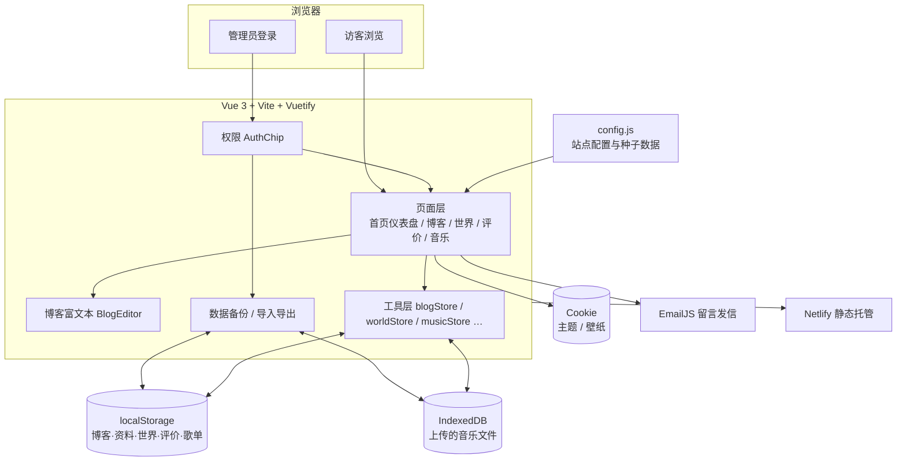

# 系统框架图

个人主页（leleo-home-page）整体架构：前端静态站点 + 浏览器本地持久化，无自建后端。

## 主架构

## 数据流（简述）

1. **配置驱动**：文案、壁纸、种子内容等写在 `src/config.js`，构建后打进静态包。  
2. **运行时写入**：管理员在页面内改博客 / 世界 / 资料 / 歌单 → 写入本机 `localStorage`（音乐文件进 IndexedDB）。  
3. **跨环境迁移**：管理员「数据」面板导出 JSON → 在另一台电脑或本地域名导入。  
4. **部署**：`npm run build` 产出 `dist/`，上传 Netlify 等静态托管；**业务数据不在服务器上**。

## 模块一览

| 模块 | 路径（示意） | 职责 |
|------|----------------|------|
| 入口 / 路由态 | `src/main.js` · `App.vue` · `app.js` | 挂载、页面切换、音乐与权限联动 |
| 站点配置 | `src/config.js` | 身份、密码、世界种子、EmailJS、壁纸等 |
| 博客 | `blogpage.vue` · `blogeditor.vue` · `blogHtml.js` | 富文本、表格粘贴、附件、序号 |
| 世界 | `worldpage.vue` · `worldStore.js` | 四象限内容 CRUD |
| 权限 / 备份 | `authchip.vue` · `dataBackup.js` | 登录会话、导出导入 |
| 音乐 | `minimusic.vue` · `musicStore.js` | 歌单与本地音频 |
| 留言 / 评价 | EmailJS · `reviewspage.vue` · `commentsStore.js` | 发信与本地评价 |

配套示意图：[`01-architecture.png`](./01-architecture.png)
